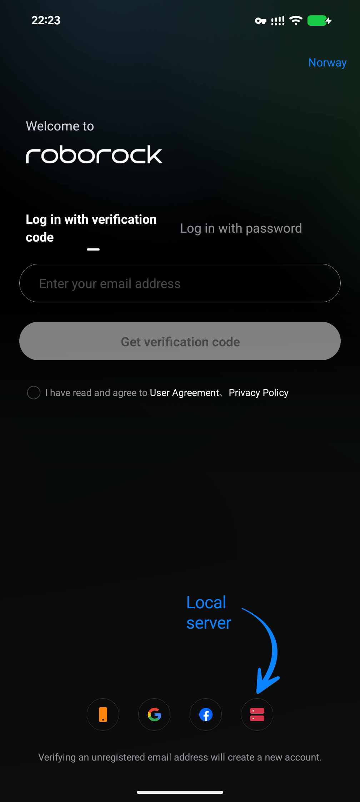
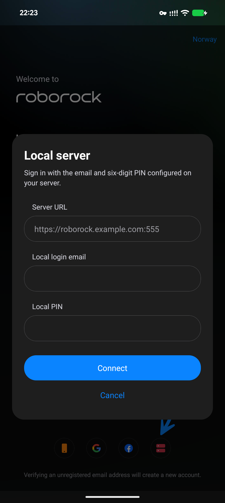

# Roborock Local Server patch for Morphe

Experimental patch for use with [Morphe](https://morphe.software), targeting **Roborock 4.76.08 (build 100944), arm64-v8a**.
Adds a Local server button to the bundled login screen, patches the native signing check, and normalizes the saved server URL.

> [!WARNING]
> Roborock Local Server add-on **1.2.1** requires additional server-side fixes: [#207](https://github.com/Python-roborock/local_roborock_server/pull/207) (missing product metadata causing device initialization error `-21020`), [#224](https://github.com/Python-roborock/local_roborock_server/pull/224) (product-ID and plugin-catalog resolution), [#209](https://github.com/Python-roborock/local_roborock_server/pull/209) (the app-agreement endpoint), and [#243](https://github.com/Python-roborock/local_roborock_server/pull/243) (the product agreement endpoint, without which the map can stay on "Loading map" after a fresh login or clearing app storage). The Android patch does **not** install these server fixes; login alone does not establish device/plugin compatibility.
>
> **A Home Assistant-managed restart, container recreation, or add-on update can discard manually applied server fixes.** Restarting the existing container with `docker restart` preserves them. When upgrading, check whether the server release already contains the fixes before reapplying a backport.

## 🩹 Patches list

<!-- PATCHES_START EXPANDED -->
> **[v1.0.0](https://github.com/NicolasBonduel/roborock-local-patches/releases/tag/v1.0.0)**&nbsp;&nbsp;•&nbsp;&nbsp;`main`&nbsp;&nbsp;•&nbsp;&nbsp;1 patches total
<details open>
<summary>📦 Roborock&nbsp;&nbsp;•&nbsp;&nbsp;1 patch</summary>
<br>

**Package name:** `com.roborock.smart`

**🎯 Supported versions:**

| 4.76.08 |
| :---: |

| 💊&nbsp;Patch | 📜&nbsp;Description | ⚙️&nbsp;Options |
|----------|----------------|-----------|
| [Local server login](#local-server-login) | Lets Roborock log in to your own Roborock Local Server instead of Roborock's cloud. Adds a server button to the login screen, where you enter the server's HTTPS address, email and PIN. Also turns off the app's signature check, which would otherwise close the re-signed app on launch. Needs a Roborock Local Server: github.com/Python-roborock/local_roborock_server. |  |

</details>

<!-- PATCHES_END -->

## Install

[Download](https://github.com/MorpheApp/morphe-manager/releases) a recent Morphe Manager on your Android phone (these instructions use Manager 2.5.0), then:

1. Tap the button below, or in Morphe open **Sources → + → Remote** and paste `github.com/NicolasBonduel/roborock-local-patches`. The source updates itself from new releases of this repository.

   <a href="https://morphe.software/add-source?github=NicolasBonduel/roborock-local-patches">
     
   </a>

2. On the home screen select **Roborock**, choose **4.76.08**, and select **No, I already have an APK** when prompted. Pick an **original, unpatched** Roborock 4.76.08 APK (build 100944, arm64-v8a). If the manual controls are hidden, enable **Expert mode** in Settings under Patching.
3. Select the **Local server login** patch. Keep the patch's required dependencies selected, tap **Patch**, then **Install**.
4. If Android rejects the upgrade, the installed Roborock app uses a different signing key: uninstall **Roborock only**, then install the patched APK instead. This clears Roborock's data — the server address, email, and PIN must be re-entered. Future updates must come from Morphe's key to preserve that data.
5. Open Roborock and follow the [Connect to your server](#connect-to-your-server) steps.

Releases are signed by this project; Morphe verifies each release against [`morphe-signing.pub`](morphe-signing.pub) in this repository and refuses a bundle that was changed or swapped after publication.

## Screenshots

<p align="center">
  
  
</p>

The arrow on the login screen points at the server icon beside the social login buttons. The dialog asks for the server URL, the login email, and the protocol PIN.

### Install from a local bundle instead

Anyone can add this repository directly; a local bundle is only needed without the source. [Build](#build-locally) or obtain `patches-<version>.mpp`, copy it into your phone's Downloads folder, then in Morphe open **Sources → + → Local** and select the file. Local sources never update on their own — pick a new file with **Update** on the source card when a new bundle comes out. **Bundle not visible in the picker?** Open the picker from **Sources → + → Local** (not the APK-selection step), browse to **Internal storage → Download** if the shortcut is stale, reopen the picker after copying files, and media-scan ADB-transferred files.

Do not patch an already-patched APK or an APK extracted from the installed patched app.

## Get the original app

Download **4.76.08 / 100944 / arm64-v8a / nodpi** from [APKMirror](https://www.apkmirror.com/apk/roborock/roborock/roborock-4-76-08-release/).
Choose the original standalone APK. Verify its SHA-256 before patching:

```text
f26660665dcb39b4688e976d16ff2dc270f31867780c3b1628f0263a6fa03203
```

On macOS or Linux, the included validator checks the complete APK against that hash:

```sh
python3 scripts/apk_profiles.py '/absolute/path/to/original.apk'
```

It prints `4.76.08` on success and exits with an error for other files.
The patch also checks the original login bundle, native library, instruction bytes, and getter structure. Do not bypass a fingerprint failure with force.

## Connect to your server

1. Open Roborock and reach the login screen. A curved arrow points at the server icon beside the phone, Google, and Facebook buttons.
2. Enter your local HTTPS URL including the port (default `555`), the server's `protocol_login_email`, and its six-digit `protocol_login_pin` — not the admin password or `admin.session_secret`. The server must already be configured with your vacuum and inventory.
3. Tap **Connect**, then check device listing, map loading, and one basic command. Force-stop and reopen the app to confirm the session persists.

The phone must reach the server over LAN or your own remote-access VPN, and the HTTPS certificate must be valid and trusted on the phone.

The form saves only the address and email; it clears the PIN after a successful login or when the dialog closes. The app's existing native account flow stores the session credentials.

## Distribution

Distribute this repository, its releases, and the `.mpp` bundle only. Original and patched Roborock APKs, including APK bundles such as `.apkm`, `.apks`, and `.xapk`, must not be committed, attached to releases, or uploaded as CI artifacts.
Direct users to APKMirror and the original APK SHA-256 above. Generated APKs are for the builder's own local use.

## Build locally

Requires Node.js/npm, a JDK capable of running Gradle 9.8.2, Python 3, and a **GitHub personal access token with `read:packages`**: the Gradle build resolves the Morphe Patches Gradle plugin and the patcher from GitHub Packages, which requires authentication even for public packages. Add to `~/.gradle/gradle.properties`:

```properties
gpr.user=<GitHub username>
gpr.key=<token with read:packages>
```

Build the shareable patch bundle:

```sh
npm ci --ignore-scripts
./gradlew buildAndroid --console=plain
```

The bundle is `patches/build/libs/patches-<version>.mpp`. Set `MORPHE_SIGNING_KEY` (or keep `morphe-signing.key` at the repository root, ignored by git) to sign it; an unsigned bundle is only valid while no signing public key is committed.

To patch, sign, and audit your own APK on the desktop, additionally download the official `morphe-desktop-2.1.1-all.jar` from
https://github.com/MorpheApp/morphe-desktop/releases/tag/v2.1.1
and save it as `tools/morphe-desktop.jar`, with Android SDK build-tools 35.0.0 available:

```sh
bash scripts/build-apk.sh '/absolute/path/to/original.apk'
```

Set `ANDROID_HOME` if the SDK is outside `~/Library/Android/sdk`.
The script verifies the original APK hash, builds and tests the bundle against it, patches it, aligns and signs the result, and audits its contents.
The locally generated APK and audit reports are saved in ignored `dist/` files. Keep `signing/roborock-local.jks` for subsequent updates; it is a development key using the standard `android` password and is excluded from source distribution.

The build compiles against the Morphe Patcher published to the GitHub Packages registry. `esbuild` transforms async functions for compatibility with the app's JavaScript engine. No extension DEX is injected into Roborock.

## Verification

The local build runs nine Node tests against the fingerprinted 4.76.08 login bundle, then audits the signed APK.
The audit requires exactly the login JavaScript asset, `classes4.dex`, and native library to change; `classes6.dex` must contain only the relocated saved-URL class. Other APK entry contents remain identical apart from signing metadata.
The native audit verifies the original hash, GNU build ID, and instruction bytes, then requires exactly one NOP replacement.
The build also runs Android SDK signature and ZIP alignment verification.

**Phone verification:** the signed 4.76.08 build was upgraded and launched on a Pixel 8 Pro, and local-server login worked with the server hotpatches described above. This does not establish compatibility with an unmodified server or every vacuum model. Full MQTT, map, command, and restart-persistence coverage remains unverified. The saved-URL patch normalizes the refactored repository getter; legacy cached-field readers still exist. Downloaded login-feature updates could supersede the bundled feature; mocked tests and APK audits do not establish compatibility with every server or vacuum.

## Troubleshooting

- **App exits immediately:** capture the crash with ADB or Android's bug report tools. This differs from a server connection failure.
- **Button missing:** note whether it ever appeared; the app may have loaded a downloaded login feature.
- **HTTPS error:** verify the hostname, port, phone connectivity, and certificate trust.
- **Email/PIN rejected:** confirm local protocol login and new connections are enabled in the server config.
- **Login accepted but opening account fails:** inspect the server logs for unsupported account, agreement, plugin, or inventory requests.
- **Devices work but maps fail:** note the vacuum model and check plugin/MQTT requests separately.
- **Source does not load in Morphe:** check that `patches-bundle.json` at the repository root resolves, and that the release listed there is accessible.

If sharing logs, remove credentials, tokens, MQTT keys, and personal identifiers first. The upstream app's existing account bridge logs account data; the patch adds no credential logging.

## References and license

- [Upstream native patch](https://github.com/Python-roborock/local_roborock_server/blob/main/patcher/patch_librrcodec.py)
- [Local server](https://github.com/Python-roborock/local_roborock_server)
- [Morphe patch API](https://github.com/MorpheApp/morphe-patcher)
- [Morphe Patches template](https://github.com/MorpheApp/morphe-patches-template), which this repository's release pipeline follows

Patch source is 0BSD (Zero-Clause BSD); see LICENSE. Morphe branding restrictions remain in NOTICE. Original Roborock app code and assets are not included in the source distribution.
